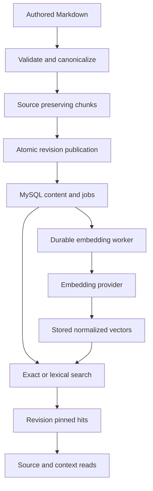

# System Map

Tribal is a synchronous Python package with a CLI over a small set of module functions. Authored Markdown is the source of truth. Validation and chunk preview are pure operations; publishing accepted content, durable indexing, and retrieval use MySQL. Public operations return ordinary dictionaries and use `TribalError` for operational failures instead of a service framework.

## Main data flow

The diagram shows dependencies, not automatic execution: ingest stores content and queues work; a separate worker calls the provider. Ordinary links outside the diagram connect these concepts in the Obsidian graph.

## Module boundaries

| Module | Responsibility |
|---|---|
| `parser.py` | Frontmatter, canonical authored bytes, diagnostics, paths, links, and vault validation. |
| `structure.py` | Shared source ranges, sections, protected blocks, and list boundaries. |
| `chunking.py` | Deterministic contiguous source chunks without overlap or silent truncation. |
| `storage.py` and `migrations/` | Connections, migrations, registry/profile rows, transactions, and generations. |
| `publication.py` | Atomic selected-batch imports, revisions, namespace/link refresh, lifecycle, and rechunking. |
| `embeddings.py` | Exact embedding input, providers, vector normalization, jobs, readiness, and activation. |
| `retrieval.py` | Complete candidate ranking, search sessions, pinned reads, and bounded source context. |
| `cli.py` and `errors.py` | Operator command parsing, JSON/text diagnostics, and safe failure envelopes. |

See [[Authoring/Parser and Link Resolution]] and [[Authoring/Source Preserving Chunks]] for the pure side. [[Storage/Publication and Revisions]] describes the publication boundary, while [[Indexing/Durable Embedding Worker]] describes asynchronous progress managed through durable rows.

## Identity and consistency

A document UUID survives path and title changes. An authored edit produces an immutable revision; derived chunks identify exact byte ranges in that revision. An embedding profile fixes the model, dimensions, input wrapper, tokenizer, normalization, and limits. Chunk IDs are database-assigned identities, and explicit rechunking replaces them. These identities serve different purposes and should not be substituted for one another.

Knowledge-base mutations lock the KB row before document/job writes. Authored knowledge and indexing generations let search sessions reject stale continuations. Provider calls occur outside database transactions, and claim tokens plus lease checks fence stale workers before they publish. [[Storage/Database and Migrations]], [[Storage/Document Lifecycle]], and [[Retrieval/Search Sessions and Cursors]] explain the details.

## Retrieval and trust boundaries

[[Retrieval/Search and Ranking]] scans eligible vectors exactly in the application or uses lexical SQL results. It is not an approximate nearest-neighbor service. [[Retrieval/Source Reads and Context]] returns source from the matched revision rather than silently using the latest note. Verification and scope are retained with hits; `applicability: unknown` does not certify that a statement applies to a new situation.

The shipped OpenAI adapter is distinct from the deterministic offline provider. [[Indexing/Embedding Inputs and Vectors]] explains their guarantees. Acceptance checks and measured limits belong in [[Testing/Validation and Benchmarks]]; no production-scale latency or live provider guarantee follows from the pilot results.

## Operator entry points

Start at [[Home]] or [[CLI/Command Reference]]. [[Operations/Vault Import Workflow]] connects setup, validation, publication, worker processing, and status. This documentation task creates only files; none of those database-changing operations has been run to import this collection.
