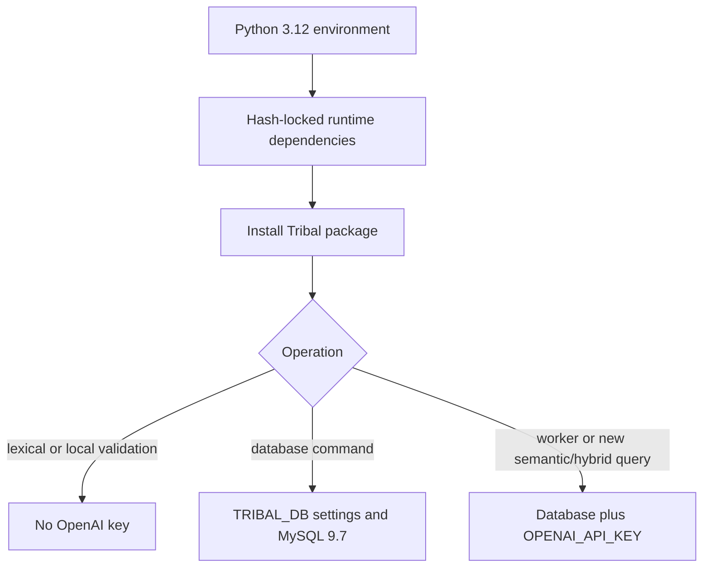

# Installation and Configuration

## Python environment

`pyproject.toml` requires Python `>=3.12`, declares the `tribal` console script, and pins the direct runtime dependencies. `requirements.lock` is generated for Python 3.12 and records transitive versions with hashes. A reproducible runtime setup can create a 3.12 virtual environment, install the lock with `python -m pip install --require-hashes -r requirements.lock`, then install the checkout with `python -m pip install --no-deps -e .`. The optional `test` extra adds pytest and pytest-cov; those are separately declared in project metadata, not in the runtime lock.

The package expects installation from the repository root so its `src/` package and packaged SQL migrations are available. The database configuration is passed through environment variables rather than a Tribal config file. Do not place credentials in notes, shell history, or committed Compose files.

## MySQL service and environment

The Compose service pins the Docker Official MySQL Community image by digest and documents its resolution as MySQL 9.7.2. Tribal's migrator checks the selected database and server version prefix, and refuses anything outside MySQL 9.7. It also requires `max_allowed_packet` of at least 64 MiB. The Compose defaults set UTF-8, UTC, that packet size, local-only port binding, and disable binary logging for a single-node development database. With binary logging enabled, trigger creation in migrations may need elevated privileges.

Configure the CLI with `TRIBAL_DB_USER` and `TRIBAL_DB_PASSWORD`; `TRIBAL_DB_HOST` defaults to `127.0.0.1`, `TRIBAL_DB_PORT` to `3306`, and `TRIBAL_DB_NAME` to `tribal`. The Compose file separately requires `TRIBAL_MYSQL_ROOT_PASSWORD` and sets `TRIBAL_DB_USER` and both passwords for container initialization. These are deployment inputs, not safe defaults. Keep them in the operator's environment or a protected local secret file.

`TRIBAL_DB_USER` is the required CLI setting: when absent, the command returns `E_ARGUMENT` with the field name and a configuration hint. Invalid ports also produce `E_ARGUMENT`. `Database.transaction` applies explicit transactions, UTC, strict SQL mode, and UTF-8 collation. See [[Storage/Database and Migrations]] for schema and migration behavior.

## Provider key boundary

Set `OPENAI_API_KEY` only for an operation that calls the OpenAI adapter. The CLI requires it for the embedding worker and for a new semantic or hybrid search; lexical search does not require it. A semantic continuation with a cursor reuses the stored search session and skips the new embedding call. Creating a profile or queueing jobs does not itself make a provider request. The live OpenAI smoke test is a separate opt-in, described in [[Testing/Validation and Benchmarks]]. No credentials belong in this vault. Provider input and vector handling are documented in [[Indexing/Embedding Inputs and Vectors]].

Installation prepares the executable and libraries; it does not initialize a schema or publish content. Database changes begin only when an operator invokes a database command such as migration or publication. The CLI scope and command syntax are listed in [[CLI/Command Reference]], and the vault-level import sequence is covered in [[Operations/Vault Import Workflow]].

## Related notes

- [[Home]] — vault entry point and system map.
- [[Operations/Diagnostics and Recovery]] — interpret configuration and migration errors.
- [[Storage/Database and Migrations]] — server and schema constraints.
