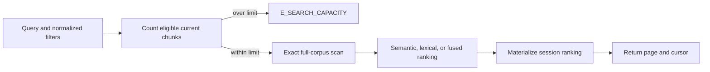

# Search and Ranking

## Calling search

The Python entry point is `tribal.retrieval.search(db, query, *, knowledge_base, ...)`. For a precise substring search without an embedding provider, call `search(db, "Go", knowledge_base="notes", mode="lexical", lexical_mode="literal")`. Defaults are semantic mode, full-text lexical mode, 20 results per page, and `max_candidates=100000`. Page size is limited to 1–100. Semantic and hybrid modes require an active embedding profile and a compatible provider; lexical mode can run without one. Provider failures and invalid query vectors are explicit errors, not silent lexical fallbacks. Query text must be nonblank and fit the profile's query input-token limit.

`domains` and `statuses` constrain the eligible set before ranking. `domains=None` means every registered domain; an empty list matches nothing. `statuses=None` defaults to active revisions; supported explicit values are active, superseded, and archived, and an empty list matches nothing. Deleted documents are excluded unless `include_deleted=True`. A supplied unknown domain is an error. The filters apply to current document heads and their current chunks, so historical revisions do not enter ordinary search results.

## Scoring and ordering

Semantic ranking computes cosine similarity against every eligible stored vector for the active profile, using the persisted float32 vector values and full precision calculations for dot product and norms. Missing vectors simply have no semantic score. Ordering is descending score, then document UUID bytes, then chunk ordinal; score values are not rounded before tie-breaking.

Lexical full-text mode uses the database's natural-language full-text relevance over title, summary, and chunk content. If that produces no eligible matches, Tribal reruns lexical ranking in literal mode and reports `lexical_mode: "literal"`. Literal search finds the complete query as a case-sensitive substring in each of those three fields; `%` and `_` have no wildcard meaning. Its score is the number of fields that contain the query (0–3), not the number of occurrences. It therefore covers short identifiers and CJK substrings. The response reports which lexical mode actually supplied the ranking.

Hybrid mode combines the complete semantic and lexical rank lists with reciprocal rank fusion: each occurrence contributes `1 / (60 + rank)`. A chunk present in both lists receives both contributions. Final ties use document UUID bytes and ordinal. The requested page limit is applied after all eligible candidates have been ranked, so the first page is not a top slice of an incomplete scan.

## Capacity and readiness

`max_candidates` guards the count of eligible current chunks before the full scan. If that count exceeds the caller's ceiling, search raises `E_SEARCH_CAPACITY` and returns no partial hits. Raise the ceiling only after measuring the deployment's database, memory, and latency capacity; narrowing domains or statuses is the other supported way to reduce the scan. Each successful new search materializes the full ranking, even if the first page is small.

The implementation default is 100,000 candidates. The opt-in exact-search benchmark is set up with 1,000 documents (and verifies exact top results and full session materialization at that size); it is a machine-specific measurement harness, not evidence that 100,000 is safe or that a run occurred during this code reading. Benchmark calls set `max_candidates` to their document count explicitly. Search responses also include indexing readiness counts for the active profile across all current, nondeleted chunks in the knowledge base, irrespective of the search's domain or status filters; a lexical result may be returned while embeddings remain pending. See [[Indexing/Embedding Profiles]] and [[Indexing/Durable Embedding Worker]] for profile and readiness behavior, and [[Storage/Publication and Revisions]] for the current-revision boundary.

See [[Home]] for the vault map, [[Retrieval/Search Sessions and Cursors]] for stable paging and expiry, and [[CLI/Search and Read Knowledge]] for the user-facing command path.
