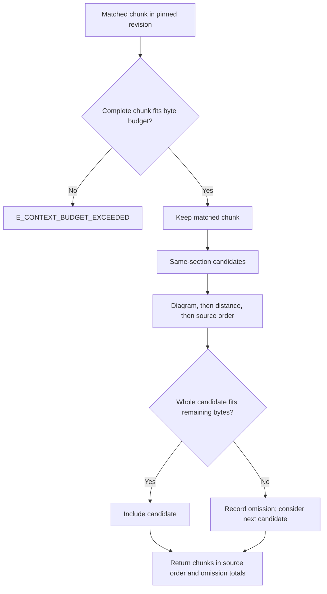

# Source Reads and Context

## Read canonical source

`tribal.retrieval.read_document(db, *, knowledge_base, document_id, revision_id=None, start_byte=None, end_byte=None)` returns canonical Markdown, title, path, metadata, and content hash. Omitting `revision_id` selects the document's current revision; supplying it pins the read to that exact historical revision, provided the document belongs to the requested knowledge base. A revision ID from a different document or knowledge base returns `E_NOT_FOUND`.

Ranges use UTF-8 byte offsets into the canonical source and are half-open: `[start_byte, end_byte)`. Supply both endpoints or neither. Tribal checks ordering, bounds, and that both endpoints fall between UTF-8 code points; a range can therefore include a four-byte character such as an emoji intact. If omitted, the read returns the full source. Chunk search hits expose their `start_byte` and `end_byte`, which can be passed directly to this method to fetch the exact original chunk text. These are source offsets, not character indexes.

## Build bounded context

`read_context(db, *, knowledge_base, document_id, revision_id, chunk_id, budget_bytes=65536)` requires an explicit revision and a chunk belonging to that document and revision. It confirms the stored chunk bytes match the canonical source slice. It selects the matched chunk plus other complete chunks in the same structural section, never neighboring headings or part of another revision. The default budget is 65,536 source bytes, not characters or model tokens. The complete matched chunk is mandatory; if it alone exceeds the budget, the call raises `E_CONTEXT_BUDGET_EXCEEDED` rather than truncating it.

Additional chunks are considered in priority order: chunks overlapping a Mermaid code range first, then distance from the matched range, then source position. A candidate is included only if the whole chunk fits the remaining budget; a large non-fitting candidate is skipped so a smaller later chunk can still fit. Returned chunks are sorted into source order. `omitted_chunk_ids`, `omitted_bytes`, `used_bytes`, and `complete` make truncation of the surrounding context visible. `complete` is false when any eligible chunk in the same section was omitted; it does not mean Tribal cut text inside a returned chunk.



Use `read_document` when a caller needs exact authored text, and `read_context` when it needs bounded nearby structure for a matched hit. The canonical revision and chunk boundaries originate in [[Authoring/Source Preserving Chunks]], while publication retains old revisions as described in [[Storage/Publication and Revisions]]. See [[Home]] for the vault map and [[Retrieval/Search and Ranking]] for hit identities and ranking.

## Practical call pattern

```python
from tribal.retrieval import read_context, read_document

source = read_document(
    db, knowledge_base="field-notes", document_id=hit["document_id"],
    revision_id=hit["revision_id"], start_byte=hit["start_byte"], end_byte=hit["end_byte"],
)
context = read_context(
    db, knowledge_base="field-notes", document_id=hit["document_id"],
    revision_id=hit["revision_id"], chunk_id=hit["chunk_id"], budget_bytes=65536,
)
```
