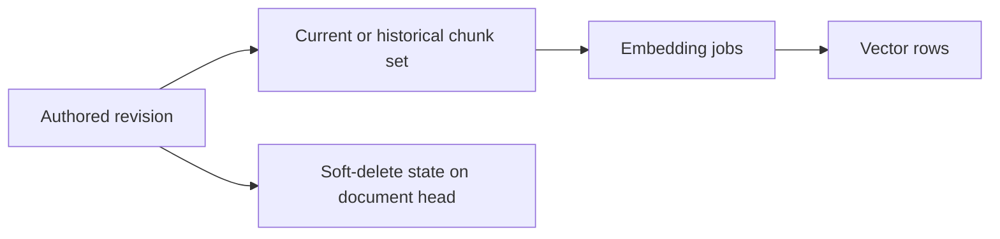

# Document Lifecycle

A Tribal document has three related but distinct states: an immutable chain of authored revisions, a current-head pointer plus optional soft-delete timestamp, and derived chunk/embedding records attached to individual revisions. A content edit adds an authored revision; deleting or restoring changes lifecycle visibility without rewriting authored content; rechunking replaces derived retrieval data without creating a revision. [[Storage/Publication and Revisions]] covers ordinary import, and [[Storage/Database and Migrations]] describes the tables and transaction lock shared by these operations.

## Soft delete and restore

`set_document_deleted()` is the explicit lifecycle API. It requires the knowledge-base key, document UUID, current expected revision UUID, and a boolean `deleted` value. A missing document returns `E_NOT_FOUND`; a head mismatch returns `E_REVISION_CONFLICT`. This prevents a stale caller from changing the lifecycle state after someone has authored a newer revision.

On a state change, it validates the final namespace and current link projection, then sets or clears `documents.deleted_at`. It keeps the revision chain, current revision ID, chunks, embeddings, and job history. It refreshes current links so deleted targets no longer resolve and restored targets become eligible again. A change advances `knowledge_generation` once; it does not increment `indexing_generation`, because no chunk set or embedding inputs changed. Repeating the same delete/restore state is an unchanged operation with no generation increment.

Deleted documents retain their path reservation, including portable Unicode/case-fold collisions. Ordinary ingestion cannot restore a deleted identity, and a changed import cannot silently claim it as a new document. A caller must restore explicitly using the current expected revision. Missing files from an import snapshot do not delete documents. These rules keep identity and path ownership stable; [[Authoring/Markdown Contract]] defines the authored lifecycle metadata such as `active`, `superseded`, and `archived`, which is separate from the database's `deleted_at` state.

## Rechunking a revision

`rechunk_revision()` regenerates one revision's chunks using the current chunking code and the stored canonical Markdown. It first reads the requested current or historical revision and captures its ordered chunk IDs, then computes the replacement layout outside the write transaction. Callers may supply `expected_chunk_ids`; mismatch returns `E_CONFLICT`. Under the knowledge-base lock, the write phase verifies that the current revision is still the captured revision (when targeting the head) and that the full stored chunk set has not changed.

Replacement is atomic: delete old embedding rows, mark jobs for those chunks `discarded` and clear lease fields, remove the old chunks, insert a complete fresh set with new IDs, and enqueue jobs for the active profile. The revision ID, authored Markdown, content hash, and revision count do not change. A historical revision can be rechunked by explicit revision ID; the current-head check applies when using the default head. Any competing set replacement invalidates the captured identity list and is rejected rather than mixing old and new chunks. Only `indexing_generation` advances, once. This matches the rechunking contract in `docs/tribal_markdown_spec.md` section 8.1.

## Authorship versus indexing work

Embedding jobs are durable, derived tasks associated with a specific chunk, profile, and exact input hash. Rechunking discards jobs attached to removed chunks and creates jobs for replacement chunk identities; it does not alter the authored revision. Provider calls are performed later by the durable worker outside the publication transaction, so a provider failure changes job state rather than document authorship. See [[Indexing/Durable Embedding Worker]] for leases, retries, and publication checks, and [[Indexing/Embedding Inputs and Vectors]] for the derived input identity.

## Related notes

[[Home]] is the graph entry point. [[Retrieval/Search and Ranking]] describes how current visibility and indexed chunks affect retrieval, while [[Operations/Diagnostics and Recovery]] covers operational repair paths.
