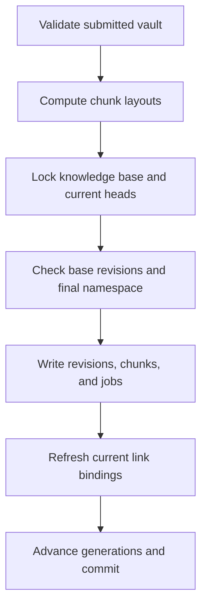

# Publication and Revisions

`ingest_vault()` treats a submitted mapping of paths to Markdown as a batch snapshot. It first validates the submitted files and computes chunk layouts before opening a write transaction. Within the transaction it locks the knowledge-base row, reads and locks current heads (including deleted reservations) in document UUID order, reloads domains, and checks the complete planned namespace. This order makes path uniqueness and optimistic revision checks safe against competing importers; see [[Storage/Database and Migrations]] for the database transaction model and [[Authoring/Parser and Link Resolution]] for validation and link interpretation.

## Revision identity and optimistic edits

The document UUID from the authored envelope survives title and path changes. A new UUID creates an initial revision. For an existing document, equality is based on canonical content hash and path. If both are unchanged, ingestion reports `unchanged`, returns the existing revision and chunk IDs, and creates no revision, chunk, or embedding job. This remains a no-op even when the submitted base token is absent or stale, and it does not repair missing derived jobs.

Any changed content or path on an existing document requires `tribal_base_revision` to equal the locked current revision ID. Missing tokens fail with `E_BASE_REVISION_REQUIRED`; stale or foreign tokens fail with `E_REVISION_CONFLICT`. New identities may ignore a foreign installation's base token because that token does not establish history in this database. The token is transport metadata removed before canonical content hashing and storage; the authored document format and token rules are in [[Authoring/Markdown Contract]]. A successful edit creates a new immutable `document_revisions` row with parent pointer and incremented revision number, preserving previous Markdown, metadata, sources, and chunks.

## Atomic batch publication

Before writing, the implementation builds the final namespace from unaffected, nondeleted documents plus submitted documents. It checks portable path collisions, including paths reserved by soft-deleted documents. If a document moves, existing paths are first staged under `.tribal-staging/<uuid>.md` within the transaction so MySQL's immediate unique constraint permits swaps. Temporary paths never commit and historical revision rows store their final authored paths.

For each changed note, Tribal inserts the new document if needed, adds revision and source records, inserts a complete new chunk set, enqueues embedding jobs, and updates the current document path/revision pointer. It then refreshes all current-revision link targets against the resulting namespace and advances knowledge and indexing generations once for the batch. These writes share one transaction: validation failures return before publication, and a database error rolls back every selected document change, job, link projection, and counter increment. Omitted files do not imply deletion. The explicit interchange rules are in section 11 of `docs/tribal_markdown_spec.md`.

The link refresh includes unchanged source documents because a newly created duplicate basename can make an old basename-only link ambiguous. It updates only current occurrences; older revision bindings remain historical evidence. New revisions insert their link occurrences. Resolved links to a missing, deleted, or ambiguous target become unresolved in the current projection, while the authored source syntax remains intact. See [[Authoring/Parser and Link Resolution]] for path and heading resolution rules.

## Failure and concurrency behavior

The knowledge-base lock serializes creates, edits, moves, deletes, restores, and derived set replacement. For two edits from the same base, one can commit; the next sees the new head and fails its revision comparison. A concurrent portable-path creator similarly loses with `E_PATH`. If a batch contains a valid file and an invalid companion, the batch is rejected without publishing either. These are code contracts covered by `tests/test_publication_contract.py`; the file is cited as acceptance evidence, not as a claim that tests ran in this documentation task.

## Related notes

Start at [[Home]] for the vault graph. [[Storage/Document Lifecycle]] describes explicit soft-delete, restore, and rechunk operations. [[Indexing/Durable Embedding Worker]] explains how jobs created here become vectors after provider work happens outside database locks.
