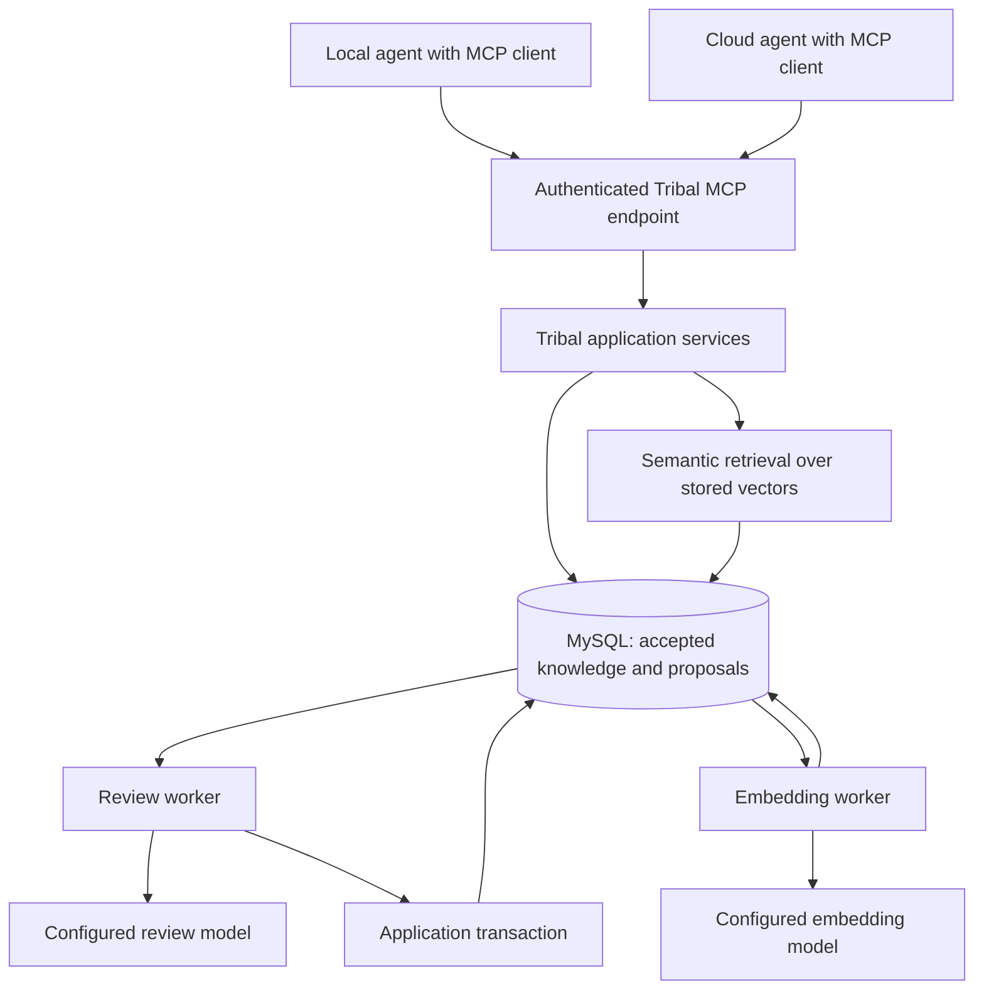

# Tribal MCP Server Design Proposal

Status: **Proposed; implementation has not started**  
Date: **2026-10-20**  
API version: **1**

## 1. Purpose and project context

Tribal lets agents reuse knowledge produced by other agents about companies, teams, products, business processes, and software. Local and cloud agents need one interface for finding knowledge and contributing additions, edits, and removals without directly modifying the accepted knowledge base. Git access is optional: a knowledge base containing only process documents, conversations, tickets, or submitted observations is a supported deployment.

This proposal introduces an authenticated MCP server and an independent review worker. Agents read accepted knowledge immediately and submit immutable change proposals. The reviewer identifies individual claims, inspects accessible evidence, assesses authority and applicability, and reports what can and cannot be established. It distinguishes documented policy, implementation behavior, and observed practice. Application code applies an approved proposal atomically, preserving document identities, revision history, and an audit trail.

This design builds on the [Tribal Markdown specification](../../../tribal_markdown_spec.md) and [proposed database schema](../../../tribal_schema.md). Their content-preservation and relationship rules remain the baseline, with the explicit knowledge-space compatibility profile below superseding their repository-only scope assumption. The companion files have not been rewritten by this proposal. Renaming storage entities and adding service records require coordinated migration; no SQL has been validated against a running MySQL server here.

Requirements use MUST for obligations and SHOULD for recommendations. Concrete limits below are initial product defaults, not limitations of MCP itself.

### Knowledge spaces and compatibility with existing documents

A **knowledge space** is the stable namespace, authorization boundary, and publication unit for a company, team, product, process, or other configured body of knowledge. A space has a UUID, stable key, display name, domains, data/admission policies, and active embedding profile. It can have zero or more connected sources. No space requires a Git remote, local checkout, default branch, or commit.

The public API uses `knowledge_space` and `list_knowledge_spaces`. In existing Markdown v1 files, the required property named `repository` is retained as a **legacy spelling for the configured knowledge-space key**. It asserts namespace membership only, not the existence or accessibility of a Git repository. A business-process document may use `repository: customer-operations`, `domain: order-approvals`, and `schema_version: 1` without any code source or commit metadata. The service resolves that value against the API's `knowledge_space` argument and rejects mismatches with `E_ASSIGNMENT`.

V1 files retain the legacy property to preserve canonical bytes, hashes, IDs, and unchanged round trips. Do not silently replace it with a `knowledge_space` frontmatter property or accept missing required metadata. A future authored-format rename needs an explicit schema-version/migration decision. Optional branch/commit scope remains useful only for code-related findings. Business scope, process versions, effective dates, and exceptions can be stated in the body, source details, and preserved `x_` extensions; omitted Git metadata is never an error.

Keep the existing source-type enums for compatibility: policies, conversations, tickets, operational records, and observations can use `web`/`issue`/`document` where their locator fits, or `other` with a nonblank locator and explanatory `details`. `details.kind` can distinguish a policy, conversation, ticket, operational record, or observation, and can identify the source connection and source version. These details do not automatically establish authority or authenticity. A code source is an optional evidence kind; a bare file path without an accessible source remains an uninspected reference.

## 2. Scope and decisions

V1 provides knowledge space discovery, embedding generation, semantic search, complete document reads, asynchronous proposal submission, status inspection, and cancellation. Semantic retrieval is the default; lexical search supplements it through explicit hybrid or lexical modes. Proposals support additions, edits including moves, explicit soft removals, and explicit restoration. A proposal can contain multiple operations within one knowledge space so a rename and its incoming-link edits can be reviewed and committed together.

Supported source situations include connected authoritative documents or business systems, optional Git mirrors, submitted excerpts with provenance, and a space with no external connectors. Admission remains available when Git or other external systems are inaccessible; the review result must state the corresponding evidence limitations.

All external knowledge operations go through MCP. The reviewer and application workers use restricted internal interfaces to the same application services. No agent receives database credentials or an unrestricted write tool.

The default admission policy automatically applies all approved operation types. It does not require a human to approve each change. Operators can pause admission through service configuration. Admission approval and authored verification remain separate concepts.

V1 excludes automatic merging, permanent deletion, cross-space transactions, background consolidation, live vault synchronization, attachment transfer, arbitrary SQL, remote shell execution, and a general-purpose agent framework. Embeddings and a working semantic-retrieval path are required launch capabilities.

### Alternatives considered

| Approach | Trade-off | Decision |
|---|---|---|
| Agents directly write documents through MCP | Smallest interface, but no consistent admission process. | Rejected. |
| Review runs synchronously inside each tool call | Fewer moving parts, but model latency and disconnects make submission unreliable. | Rejected. |
| Durable proposals with an asynchronous reviewer | Adds a worker and proposal records; supports retries, inspection, and controlled application. | Recommended. |

## 3. Architecture and trust boundaries



The MCP adapter handles protocol behavior and translates tool calls. Application services enforce authorization, Markdown rules, knowledge space boundaries, and transaction rules independently of the transport. MySQL is the durable source of truth for documents, proposals, review attempts, and work scheduling.

The reviewer assembles a bounded evidence package from Tribal and whatever configured sources are accessible, requests a structured model judgment, and validates that judgment. Source connectors are optional read-only integrations for documents, discussions, ticket/workflow systems, operational records, or Git. The reviewer cannot directly update accepted documents. The application worker applies only the exact approved proposal through the transaction in Section 10.

V1 uses a database-backed queue, avoiding a second queue service. MCP and worker processes can be deployed from the same service package and scaled separately. No model request or external evidence fetch occurs while holding document write locks.

## 4. Connecting local and cloud agents

Deploy one service endpoint such as `https://tribal.example.com/mcp` using Streamable HTTP. A local desktop/CLI agent and a cloud agent use the same endpoint, authorization, and tool contracts. The cloud runtime must support remote MCP and have network access to the endpoint; support is a client capability, not something Tribal can assume for every agent platform.

The protocol target is MCP **2026-07-28**. Use a conforming SDK and pin its version when implementation begins. Advertise supported versions and reject unsupported requests according to MCP; do not hand-code a partial imitation of protocol negotiation. If initial clients require earlier protocol revisions, add and test an explicit SDK compatibility mode before advertising them. V1 does not require the legacy HTTP+SSE transport.

Streamable HTTP and stdio are standard MCP transports. V1 needs only HTTP. A future stdio adapter can forward calls from local-only clients to this same service; it must preserve each caller's identity and must not become an alternative path to the database. See the [MCP transport overview](https://modelcontextprotocol.io/specification/2026-07-28/basic/transports).

Use HTTPS and MCP's HTTP authorization model with an OAuth authorization server. Interactive clients can authorize a user; unattended workers use separately provisioned service identities and a supported authorization-server flow. Do not assume every client implements unattended authorization. Tokens must be issued for Tribal, validated on every request, and never accepted as credentials for downstream services. Validate supplied Origin headers against deployment configuration. The authorization server and secret storage are deployment dependencies, not new systems implemented inside Tribal. See [MCP authorization](https://modelcontextprotocol.io/specification/2026-07-28/basic/authorization) and [Streamable HTTP requirements](https://modelcontextprotocol.io/specification/2026-07-28/basic/transports/streamable-http).

## 5. Identity and permissions

Authentication produces a stable principal ID and principal type (`human`, `agent`, or `system`). Client-reported names and authored `verified_by` metadata are not authenticated identities. Revision authorship records the submitting principal; audit records separately identify the reviewer and applying service.

Permissions are knowledge-space-scoped:

| Capability | Allows |
|---|---|
| `knowledge:read` | Discover the permitted knowledge space and domains, search, and read documents/history. |
| `knowledge:propose` | Submit changes and inspect/cancel one's own proposals; requires read permission too. |
| `proposals:manage` | Inspect all proposals in a permitted knowledge space and cancel pending ones. Does not bypass review. |
| Internal review/apply roles | Claim work or apply a validated outcome through private service interfaces. Not public MCP tools. |

Knowledge space configuration and permission grants are operator-managed in v1. Spaces/domains cannot be created by misspelled metadata or model suggestions. Every lookup, pagination request, evidence fetch, and write must enforce knowledge space permissions. Document IDs and revision IDs must belong to the requested knowledge space. Unauthorized objects return the same not-found response as absent objects.

Each optional source connection is explicitly bound to a space, with read access, credential references, and a data-sharing policy. Space membership alone does not grant access to every external source: connectors enforce the caller/service's authorized source view. Do not expose restricted source excerpts, source existence, or claims derived exclusively from them through broadly readable accepted documents. A proposal relying on restricted evidence needs an authorized shareable citation or redacted support before admission to a wider audience. Record inaccessible evidence as unavailable without leaking its private contents.

The submitter must remain active and retain the required knowledge space permissions when a proposal is applied. The application must recheck the authoritative grants; an access token expiring after submission does not itself cancel durable work. Revoked grants do prevent application.

## 6. MCP tool contracts

Expose tools with strict JSON input schemas, structured output schemas, and concise descriptions. Unknown tool arguments are rejected. Tool annotations describe reads and mutations but do not authorize them. Use the chosen SDK's MCP error/result envelopes rather than inventing another protocol. The tables below describe tool arguments and structured payloads, not raw JSON-RPC envelopes. See [MCP tools](https://modelcontextprotocol.io/specification/2026-07-28/server/tools).

| Tool | Main inputs | Structured result |
|---|---|---|
| `list_knowledge_spaces` | Optional cursor and page size. | Authorized knowledge space keys, domain keys, effective capabilities, active embedding profile, indexing coverage, and next cursor. |
| `search_knowledge` | Knowledge space key, query, mode (`semantic` by default, `hybrid`, or `lexical`), optional domain/kind/lifecycle/verification filters, scope context, cursor, page size. | Revision-pinned passages, semantic scores/profile when applicable, provenance, indexing coverage, diagnostics, and next cursor. |
| `get_document` | Knowledge space key, exactly one of document UUID or exact vault path, optional revision UUID. | Document UUID, canonical Markdown, vault path, revision UUID/hash, interpreted metadata, sources, shareable claim assessments/limitations, links, and deletion state. |
| `list_document_revisions` | Knowledge space key, document UUID, optional `include_deleted`, cursor, page size. | Revision UUIDs, parent UUIDs, revision numbers, historical paths, creation timestamps, submitter attribution, change summaries, content hashes, and next cursor; newest first. |
| `propose_change` | Knowledge space key, idempotency key, reason, operations, optional evidence attachments and predecessor proposal ID. | Proposal UUID, immutable payload digest, state, diagnostics, and polling guidance. |
| `get_proposal` | Knowledge space key and proposal UUID. | State, submitted operations, diagnostics, review attempts, claim assessments/access limitations, reasons, and per-operation application results, filtered by current source permissions. |
| `list_proposals` | Knowledge space key, optional state, cursor, page size. | Own proposals, or all knowledge space proposals with manage permission. |
| `cancel_proposal` | Knowledge space key and proposal UUID. | Current durable state and whether cancellation took effect. |

`get_document` defaults to the current revision of an undeleted document; an explicit historical revision or `include_deleted: true` may retrieve retained history under the same knowledge space read grant. An explicit revision is checked against both document and knowledge space ownership. The additional `include_deleted` argument is a boolean defaulting to false.

Path lookup uses the exact case-sensitive current `vault_path` inside the requested knowledge space; it does not search historical paths, titles, aliases, or lexical indexes. Return the resolved stable document UUID so callers can follow later moves. A soft-deleted document still reserves its path but is not returned by a path-only lookup unless `include_deleted: true`. When a revision UUID is supplied with a path, resolve the current path first and then verify that revision belongs to the resolved document; an old historical path is not an alternate identity. Missing and unauthorized targets use the same not-found result.

`list_document_revisions` provides discovery without exposing private proposals. It requires the same knowledge space read grant; listing a soft-deleted document requires `include_deleted: true`, defaulting to false. Each listed revision can then be read with `get_document`. Results are ordered by descending revision number and paginated with the list limits below. Deletion/restoration do not invent revisions, so this history is authored-content history rather than an audit-event listing.

Default limits: 20 search hits, maximum 100; 20 list entries, maximum 100; 2 KiB query text; 8 MiB canonical authored Markdown per document, matching the Markdown specification; 20 operations and 64 MiB decoded proposal payload including attachments. Validate the format's decoded-field/projection limits too. One document UUID can occur only once per proposal. Document reads are complete within this authored size limit and must never silently truncate. Oversize legacy documents produce `E_LIMIT` rather than partial Markdown. Search passages may be shortened for display only if marked as excerpts with their exact byte ranges; full chunks/documents remain readable.

Configure HTTP/proxy limits, client/server packet sizes, and strict SQL mode to carry these decoded representations, their JSON-escaped transport forms, derived records, and the permitted transport metadata line. Operational capacity failures are distinct from format errors. A deployment lowering the 8 MiB file capacity must advertise a restricted ingestion profile rather than full Markdown-v1 ingestion. Format-valid proposals that exceed the review model's context budget follow the needs-evidence behavior in Section 9.

Opaque, signed cursors bind the caller, knowledge-space UUID, query/mode/filters, sort position, and `knowledge_generation`. Search cursors also bind the active profile and indexing generation; store the query vector behind an opaque server-side search handle so subsequent pages reuse the same vector. Reauthorize every page; expire cursors/handles after 15 minutes or a relevant generation/profile change and ask the caller to restart. V1 offers polling with `retry_after_seconds`, not subscriptions or callbacks. No MCP sampling capability is required: the service owns and pays for its reviewer and embedding model invocations.

### Operation shapes

Every operation includes `operation`, `document_id`, and a nonblank operation-specific `reason`.

| Operation | Additional required fields | Preconditions |
|---|---|---|
| `add` | `vault_path`, complete `markdown`. | UUID is unknown globally; path is available in the knowledge space. |
| `edit` | `expected_revision_id`, `vault_path`, complete replacement `markdown`. | Existing undeleted document; same document/knowledge space identity. A path change is an explicit move. |
| `remove` | `expected_revision_id`. | Existing undeleted document; soft deletion only. No replacement Markdown. |
| `restore` | `expected_revision_id`. | Existing soft-deleted document; restore its current content and reserved path unchanged. Subsequent edits use a separate proposal. |

V1 sends complete replacement files instead of patches so review and hashing refer to exact authored bytes. The Markdown's `id` and legacy `repository` property must agree with the operation's document UUID and API knowledge-space key under the compatibility profile in Section 1. Paths, domains, content, sources, warnings, and transport base tokens follow the Markdown specification. For a changed existing document, a supplied `tribal_base_revision` must agree with `expected_revision_id`; conflicting arguments fail. Addition into an unknown ID follows the specification's foreign-token rule.

Unchanged content and path on an undeleted document is a no-op, even with an absent/stale expected revision, as the Markdown specification requires. Such an edit may omit `expected_revision_id`; all changed edits require it. No-op operations are retained in the receipt but excluded from model review and document writes. A fully unchanged submission returns an immediately applied no-op receipt. It must not restore a deleted document or bypass authorization. Recheck no-op status during application of a mixed proposal.

### Example submission

```json
{
  "knowledge_space": "customer-operations",
  "idempotency_key": "order-approval-policy-2026-10-20-1",
  "reason": "Record the documented approval policy and its evidence limits.",
  "operations": [
    {
      "operation": "add",
      "document_id": "c872961a-a709-46c8-9b82-189bbeb51a34",
      "vault_path": "order-approvals/Manager approval threshold.md",
      "reason": "Preserve the policy's effective date, scope, and exceptions.",
      "markdown": "<complete conforming Tribal Markdown file>"
    }
  ]
}
```

The Markdown placeholder above describes a string argument; it is not an ingestible document. Its complete file must use `repository: customer-operations` under the legacy envelope. The worked review example in Section 9 illustrates its business-process claims without assuming a Git repository.

## 7. Submission and idempotency

Submission first authenticates and checks current knowledge space permissions and payload limits, then performs state-independent parsing/canonicalization and computes the request digest. It looks up the scoped idempotency key before checking mutable document or vault preconditions. A matching stored digest returns the existing receipt even when its addition now exists, its edit base is now stale, or its document was later removed. A different digest returns `E_IDEMPOTENCY_CONFLICT`. Recovery still requires the caller's current authorization.

Only a genuinely new key proceeds to validation against the planned final vault state. Inside an admission transaction, first insert the provisional proposal row under the scoped unique key, then perform mutable-state validation and record its final initial state and queued work. The row remains uncommitted and unavailable to workers until validation succeeds; failure rolls it back and reserves no key. A concurrent unique-key insertion loser waits for the winner, rolls back its own transaction, retrieves the committed winning row using a fresh/current read, compares digests, and returns that receipt or conflict. If the winner rolled back, retry acquisition rather than inventing a receipt. This prevents the winner's changed document state from producing a spurious validation error in a retry. Failed structural validation returns diagnostics and publishes no knowledge or review work. It is not a semantic rejection by the model. Valid submissions remain private to their submitter/managers and internal workers until applied; they are excluded from search, document reads, graph lookup, and export of accepted knowledge.

A proposal payload is immutable. Its digest covers the versioned deterministic serialization of knowledge space, authenticated submitter, ordered operations, canonical Markdown, paths, expected revisions, reasons, predecessor ID, and supplied evidence. Store the serialized bytes and their SHA-256 digest; do not depend on database JSON serialization. Canonicalization only performs the Markdown specification's permitted normalization and transport-line removal. Keep original submitted text for diagnostics, whose locations follow the Markdown specification.

The idempotency key is required, nonblank, and at most 128 characters. Its unique scope is `(submitter_id, knowledge_space_id, key)`. Repeating a successful submission with the same normalized payload returns the same proposal, including after completion. Reusing its key with different content returns `E_IDEMPOTENCY_CONFLICT`. Serialize concurrent submissions with the database unique constraint. Idempotency records are retained with the proposal; there is no automatic key expiry in v1. Invalid requests do not reserve a key.

A caller who revises rejected content, supplies more evidence, or reconciles a conflict submits a new proposal with a new key and optional `predecessor_proposal_id`. The predecessor must be visible to that caller and in the same knowledge space. It does not inherit approval. Disconnecting or cancelling the MCP request after the submission transaction commits does not cancel the durable proposal; retrying the same key recovers its receipt.

## 8. Review lifecycle and reliability

| State | Meaning | Next states |
|---|---|---|
| `queued` | Durably accepted for review. | `reviewing`, `cancelled`. |
| `reviewing` | A leased worker is collecting context or judging the proposal. | `applied`, `rejected`, `needs_evidence`, `conflicted`, `failed`, `cancelled`; or `queued` after a retryable failure. |
| `applied` | All operations committed, or the receipt records only no-ops. | Terminal. |
| `rejected` | The reviewer found an admission-policy problem. | Terminal. |
| `needs_evidence` | Material claims cannot be evaluated with the available support. | Terminal; resubmit with additional support. |
| `conflicted` | Reviewed bases, relevant knowledge space state, policy, or grants are no longer valid. | Terminal; reconcile and resubmit. |
| `failed` | Technical processing failed after retries. | Terminal; operator investigation or a new submission. |
| `cancelled` | Submitter/manager cancellation won before application. | Terminal. |

Approval is a review verdict, not a publicly actionable state or MCP tool. An approval attempt can exist without an applied change if a conflict or crash intervenes. Clients treat only `applied` as a successful mutation and receive the exact new revision IDs or deletion/restoration receipts.

Workers claim queued rows atomically, with a monotonically increasing claim token, a 120-second lease, and renewal at least every 30 seconds. Persist a database-clock attempt deadline five minutes after the claim. All outcomes and lease renewals must compare the claim token and expected nonterminal state. An expired or cancelled worker may finish a model call but cannot authorize an effective decision or application. Cancellation and application lock the proposal row so exactly one wins; cancelling an applied proposal returns its existing terminal state.

Renewal must also atomically require that the existing lease and attempt deadline are both unexpired according to a fresh database-clock reading. Set the new expiry to the earlier of 120 seconds from that reading or the fixed attempt deadline. A heartbeat after expiry must fail even if the sweeper has not reclaimed the row. Failed renewal stops effective work and leaves recovery to the sweeper; it cannot resurrect a claim or extend the attempt deadline.

The application authorization point is the final conditional proposal-state update after all required locks and validations. Using a fresh database-clock reading at that statement, require a matching claim token, `reviewing` state, unexpired lease, and unexpired attempt deadline. Zero affected rows means rollback of the whole transaction, including tentative document writes. A lease expiring while waiting for locks therefore cannot authorize application. Expiry after a successful final authorization update does not retroactively revoke that transaction; commit makes its already-authorized outcome visible. Cancellation or reclamation waits on the row lock and then observes the terminal result. Other worker outcomes use equivalent fenced final updates.

Use at most three processing attempts with 5-second and 30-second retry delays for transient model/network/database failures; terminal exhaustion becomes `failed`. Expired worker leases count as failed attempts and are reclaimed by a sweeper. Malformed model output is a technical failure, never an implicit approval. Reject/needs-evidence verdicts do not automatically retry. Bound a processing attempt to five minutes; abort model/evidence work on cancellation or deadline. Expose attempt count, last safe error, and next retry time.

## 9. Reviewer inputs, evidence, and decisions

### Consistent review context

Before contacting the review model, use hybrid retrieval to identify related knowledge and materialize a consistent database snapshot containing the proposed final state, current target revisions, retrieved passages, backlinks, and metadata. Embed proposal titles, summaries, and operation reasons as review queries using the space's active profile; these temporary query vectors do not publish draft content to accepted knowledge. Record the profile, query inputs, coverage, knowledge/indexing generations, admission-policy version, and exact context included. Retrieval cannot be represented as an exhaustive proof that no conflicting knowledge exists. If semantic retrieval is unavailable, use the technical retry/failure path rather than silently judging with lexical retrieval alone.

For v1, any accepted document mutation in the knowledge space increments `knowledge_generation`. Publishing/removing embeddings, replacing chunks, or changing the active embedding profile increments a separate `indexing_generation` under the knowledge space lock. Application requires both captured generations and the profile still to match. This intentionally conservative rule catches changes to related knowledge, link resolution, and newly discoverable contradictions without maintaining a complex dependency graph. An unrelated concurrent change or embedding publication can therefore produce a conflict. Derived publication does not create an authored revision.

The reviewer must account for accepted current content missing from the active embedding profile. It may inspect that unindexed content directly within its context budget and record the coverage gap. Otherwise wait/retry for pending indexing; if missing content is permanently unembeddable or still unavailable after retries, return `needs_evidence` with the indexing limitation and corrective action. Incomplete coverage must not silently count as proof that no duplicate or contradiction exists.

The context builder first includes every target's old and proposed content, operation reasons, lifecycle/link impact, and material evidence. It then selects related passages within a published model-context budget. Store selected revision IDs, source spans, search terms, exclusions, model version, prompt version, and policy version. If required content or material evidence cannot fit, return `needs_evidence` with a request to split the proposal or narrow the claim; do not silently truncate required material and approve anyway.

### Available evidence and source authority

Sources in canonical Markdown remain the document's durable evidence references. Evidence can come from policies, process manuals, decision records, discussions, tickets, operational/audit records, agent observations, or optionally code and tests. No Git connection or source commit is required. Proposal attachments add review support such as excerpts, observations, or transcripts; they are separate immutable UTF-8 text objects with a source locator, optional source version, content hash, and provenance. Limit each attachment to 256 KiB and 20 attachments per proposal within the overall proposal limit. Essential support must also have a shareable citation and explanation in the proposed document rather than exist only in a private attachment.

The reviewer checks accessible configured sources and submitted material. It cannot assume access to a company's systems, files on a submitter's laptop, or a Git checkout. A space with zero external connectors must still support search, proposals, and admission of useful explicitly unverified findings. Submitted observations remain attributed reports unless independently corroborated; copying a report into Tribal or another document does not create independent support.

For each inspected source, record its locator, connection when applicable, source version or document revision if available, observation/retrieval time, hash and snapshot, origin/author attribution, and whether it was independently retrieved or supplied by the submitter. Record applicable business unit/process, effective dates, and exceptions when available. Git commits are one optional version identifier alongside policy versions, ticket/event IDs, and document revisions. Floating Tribal-document sources are pinned to the revision inspected. Restricted and unavailable sources are recorded without exposing private data.

Source authority is configured for the space and claim category: for example, an approved policy register may establish intended policy while workflow audit records establish observed execution. An authenticated process-owner statement can establish an attributed decision within that owner's recorded remit. A name in free text, recency, or a high semantic similarity score does not confer authority. Where no authoritative source is designated or ownership is unclear, preserve that limitation rather than let the model invent one. Competing authoritative sources produce an explicit conflict; the model must not silently choose a policy winner.

V1 performs no arbitrary shell commands and does not execute tests named in sources. Optional external fetches require configured read-only connectors, service-owned credentials, authorized source namespaces/hosts, byte/time limits, and redirect/address validation. No general URL browser or arbitrary filesystem reader is available to the model. Proposed text, retrieved knowledge, diagrams, and evidence are untrusted data: they cannot modify reviewer instructions, grant permissions, or trigger actions. Model and embedding providers must be approved for the space's data policy; a disallowed provider cannot receive its content. Executable verification would be a separate scoped capability, not an assumption of this design.

### Claim-level assessment

The reviewer decomposes material assertions into individually assessable claims and classifies what they describe: documented policy or intent, implementation behavior, observed practice, or an attributed report. It retrieves related support and counterevidence through semantic/hybrid search, inspects the underlying available sources, and checks authority, scope, dates, exceptions, and source independence.

Each claim receives `supported`, `contradicted`, or `inconclusive`, with exact source references, the inspected source versions/times, declared scope, assessment method, and limitations. Inconclusive includes missing access, insufficient support, unclear authority, and unavailable operational data. An infrastructure failure is not counterevidence. Failure to retrieve a contradiction is not proof of truth. Support is always scoped to what was inspected; documenting a policy does not independently establish that people or software follow it.

These claim assessments are append-only review evidence associated with the exact accepted revision, not new values of the Markdown `verification_state` enum. They remain separate from the admission verdict and are exposed with the accepted revision's provenance. Public read results use only the shareable rationale and evidence; source-restricted review details remain private. Search results identify whether material claims are inconclusive or conflicting even if a document's lifecycle is active.

Where policy and practice differ, Tribal should preserve that difference with attribution rather than flatten it into a single fact. A proposal asserting an unsupported fact needs correction or additional evidence; a proposal explicitly reporting uncertainty or disagreement may be valuable and admissible. Missing Git or business-system access alone is never a format/admission error, and it never justifies an automatic verification upgrade.

### Worked business-process example

For the illustrative claim **"Orders over $10,000 require manager approval"**, evaluate the assertions separately:

| Assertion | Available evidence | Permitted conclusion |
|---|---|---|
| This is the intended policy. | Authorized policy version 3, effective October 1, covering the stated business unit. | Supported as the documented policy within that scope. |
| The application enforces it. | No accessible implementation or independently executed test. | Inconclusive; enforcement was not checked. |
| Every order follows it. | A sample of authorized workflow records, or no operational access. | Report the sample and its limits, or mark observed practice inconclusive; do not infer universal compliance. |

A useful admitted finding could state: "The operations handbook requires manager approval for orders over $10,000, effective October 1. Application enforcement and manual exceptions have not been independently checked." It can remain authored `unverified`; evidence-backed support for the policy claim does not automatically verify the whole document. If another source documents a different threshold, record the disagreement and applicable dates/authority rather than overwrite one side without justification.

### Admission rubric

The reviewer evaluates whether the proposal adds useful knowledge, is supported at the declared verification level, states applicability clearly, duplicates or contradicts existing knowledge, and preserves important history and links. Warnings permitted by the Markdown format do not become hard format errors; semantic rejection must explain a material knowledge-quality concern.

For removals, the reviewer sees the full current document, evidence, incoming references, and proposed explanation. Prefer an explicit superseding edit when it preserves useful history and guidance, but allow justified soft removal. Missing replacement content is not itself an error for a removal.

The required structured verdict is `approve`, `reject`, or `needs_evidence`, with a concise rationale, per-operation findings, claim-level assessments, source-access limitations, evidence references, unresolved concerns, and suggested next actions. All verdicts must reference the proposal digest. The server validates the output schema, referenced operation/evidence/claim IDs, shareability, and policy constraints. One non-approved operation prevents application of the entire proposal. V1 does not use a model's numeric confidence as an admission threshold.

Approval never rewrites the proposal. Suggested changes require a new submission and review. Approval also never upgrades `verification_state`. A proposed `verified` document must meet the Markdown requirements and have evidence adequate for its material claims. `verified_by` remains authored attribution; the service records the authenticated submitter and reviewing agent separately. An unverified but useful scoped finding may be admitted. Inaccessible evidence leads to `needs_evidence` when it is necessary for a decision, rather than proof that a claim is false.

V1 promises assessment against recorded snapshots, not continuous proof that an external process remains unchanged. Inspect a stable source version when available, and label mutable/unversioned evidence with its observation time. Source-connection permissions, authority rules, and freshness budgets are versioned admission-policy inputs; changes invalidate pending review contexts. Recheck that policy and snapshot ages before application, with any required refetch done before database locks. An expired evidence budget requires fresh review; absent version/freshness guarantees remain visible limitations. Future source-change monitoring is outside v1.

## 10. Applying approved proposals

Resolve the proposal's immutable knowledge space identity before opening the application transaction. Its first database operation locks that knowledge space's `knowledge_spaces` row with `SELECT ... FOR UPDATE`, followed by the proposal row and then target document rows in ascending UUID order. All knowledge-mutation paths follow this space-first order, including derived chunk/embedding publication. Workflow-only claim, heartbeat, cancellation, and reclamation transactions may lock just the proposal; they must not acquire a knowledge space lock afterward. Cancellation still races application through the proposal row and never reverses the lock order.

1. After locking the knowledge space and proposal rows in that order, check their ownership agrees, the proposal is still `reviewing`, its claim token/lease are current, and its validated approval references the stored payload digest and evidence/context package.
2. Recheck knowledge/indexing generations, active embedding profile, policy version, submitter grants, source/shareability grants, reviewer service authority, provider policy, and evidence freshness budgets. A mismatch or expired evidence budget produces `conflicted` and no document writes. Use locking/current reads for all database-dependent checks rather than a previously established read snapshot; external refetches require returning to review outside the transaction.
3. Lock existing target documents and check their expected revision IDs and deletion states. Recheck IDs, configured assignments, no-ops, all decoded-field limits, and portable path uniqueness against the complete planned final vault state, including unaffected and soft-deleted reservations. IDs cannot change knowledge space ownership.
4. Stage affected existing paths as described below before assigning final paths or inserting additions. For additions/edits, insert full immutable revisions, extract metadata/sources/links, generate conforming source-span chunks, and update current pointers and final paths. For a removal, set `deleted_at` and preserve the current revision and reserved final path. For a restore, clear `deleted_at` without fabricating a content revision. Attribute authored revisions to the submitter and record the proposal in the audit trail.
5. Recompute resolution for every internal link occurrence in current revisions of all nondeleted documents in the knowledge space, including sources outside the selected batch. Resolve against the final namespace: archived/superseded targets still resolve; deleted targets do not. Clear obsolete bindings when targets become missing or ambiguous, and retain explicit diagnostics for unresolved headings. Persist current diagnostics without rewriting authored links or historical source bindings. This full refresh follows Markdown Section 11.5 and becomes visible atomically with the changed heads.
6. Increment `knowledge_generation` once if any accepted state changed. Store per-operation results, the effective review outcome, audit events, and durable embedding jobs for every new chunk in the active profile in the same transaction. Restores enqueue missing jobs while reusing compatible retained embeddings. Immediately before commit, authorize `applied` through the final conditional state update defined in Section 8, after all locks and other writes; if the lease/deadline expired or the claim no longer matches, roll back. Commit everything together. `applied` means the authored change committed; semantic indexing has its own observable readiness.

Any failure rolls back all accepted knowledge changes. A changed base produces `E_REVISION_CONFLICT`; space-generation, profile, evidence-budget, or policy changes produce `E_REVIEW_CONTEXT_CHANGED`. If work already committed before a crash, the next worker sees `applied` and cannot apply it twice. Model calls and embedding delivery may occur more than once; their results must be idempotent.

MySQL checks `uq_document_path` immediately. To support occupied-path swaps and moves into vacated paths, stage affected existing rows at `.tribal-staging/<document-uuid>.md` inside the transaction before assigning any final paths or inserting additions. This reserved prefix cannot be authored or exported. Stage only `documents.vault_path`; historical revisions contain their final authored paths. Restore every staged row to its final path before commit, create no staging revisions, and roll back all staging on failure. Readers use committed snapshots, never dirty reads. Soft-deleted documents keep their reserved final paths, including in portable collision checks.

All selected operations form one atomic batch. An MCP client importing files must submit the complete selected batch as one proposal; it must not silently split a batch to evade limits or atomicity. Over-limit batches are rejected. Missing files never imply deletion. Ordinary snapshots are read through the service; a future bulk export tool must follow the Markdown specification's consistent-snapshot and transport-token rules.

## 11. Retrieval and portability behavior

Default search returns only current revisions of undeleted `active` documents. It includes verified, unverified, and disputed documents, with their verification state visible. Clients may request other lifecycle states explicitly; deletion/history access remains explicit. Search never mixes a passage from one revision with another revision's title, scope, or evidence.

Apply authorization and knowledge space/domain/lifecycle filters before ranking. `semantic` mode embeds the query and ranks eligible chunks by cosine similarity in the knowledge space's active embedding profile. It must retrieve passages with related meaning even when the query and passage share no keywords. UUID and exact-path lookup remain independent of vector/lexical tokenization. Semantic queries need nonblank text; lexical stopwords must not suppress a valid semantic query.

`lexical` mode uses MySQL full-text indexes over title/summary and chunk content. `hybrid` mode combines complete semantic and lexical rankings using reciprocal-rank fusion with equal weights and constant 60, keyed by chunk ID; document-level title/summary matches contribute to their chunks' lexical score. Return the actual mode and score type, using document UUID/chunk ordinal as deterministic tie-breakers. Never silently change a semantic/hybrid request to lexical mode when the embedding provider fails; return `E_SEMANTIC_UNAVAILABLE` with retry guidance. A caller can explicitly request lexical mode during an outage.

Scope context may describe a business unit, process, process version, environment, or as-of date; branch and commit are optional code-specific context. Return each hit's declared scope and a compatibility assessment (`declared_match`, `declared_mismatch`, or `unknown`). Use explicit structured authored declarations or revision-bound claim assessments for deterministic comparisons; unstructured or missing applicability remains `unknown`. Do not invent effective dates or infer universal applicability. A different commit is `unknown` unless other declarations establish a mismatch, not proof of staleness. Default ranking puts declared mismatches after matches and unknowns; callers may exclude mismatches explicitly. Never infer Git ancestry without an optional authorized Git connector. A space with no Git metadata must support normal semantic retrieval.

Every hit contains document/revision UUIDs, current path, title, heading context, source byte range, passage text, verification state, declared scope, supporting source references, and available shareable claim-assessment limitations. Link results expose unresolved/ambiguous status. Provenance refers to the same accepted revision as the passage. Review-derived scope is returned with its assessment/source attribution, not silently inserted into canonical Markdown.

Each document/graph/search operation uses one committed read snapshot, joining passages and link occurrences to the same document heads. Reading heads and link bindings in separate autocommit snapshots is not a consistent operation. Optimized projections or caches must preserve the full-refresh baseline's results and publication atomicity.

### Embedding profiles and retrieval backend

Each knowledge space must configure an active immutable embedding profile before enabling semantic search and automated admission. The profile fixes provider/model/version when available, dimensions, cosine metric, normalization, input/token limits, and deterministic document/query templates. Document inputs include title, heading ancestry, and complete chunk source; exact input bytes determine `input_hash`. Query vectors must use that same embedding space. Validate dimensions, finite values, and nonzero norm before storage or scoring; equal dimensions alone do not establish compatibility.

Store vectors in the existing MySQL `chunk_embeddings` table. The baseline v1 backend streams all eligible current vectors from one committed snapshot and calculates exact cosine similarity in the application, using bounded working memory; it does not preselect candidates by keyword. This supplies semantic retrieval on Community Edition without assuming its SQL includes `DISTANCE()`. Query work is linear in eligible vector count times dimensions, so benchmark the target corpus and set operational timeouts. If a query cannot finish within budget, return a capacity error rather than a truncated scan presented as complete. An indexed vector backend can replace this exact scorer when corpus growth warrants it, preserving filtering, provenance, and score semantics. MySQL documents `DISTANCE()` as limited to HeatWave on OCI and MySQL AI; see [vector-function availability](https://dev.mysql.com/doc/refman/9.7/en/vector-functions.html).

Create the query vector before opening the read snapshot. Then recheck current authorization, data policy, and active profile; retry if the profile changed during the model call. Never hold a database transaction open across an embedding API request. Vectors from different profiles are never mixed in one ranking. To migrate models, create a new profile, backfill its current chunks, and explicitly activate it under the knowledge space lock once coverage has been evaluated; increment indexing generation and invalidate old cursors/review contexts. Keep the previous profile available for an explicit rollback.

### Indexing lifecycle and visibility

The required embedding worker consumes durable jobs, performs model calls outside locks, validates vectors, and publishes under the knowledge space lock. Jobs carry exact chunk ID, profile, input hash, claim token, and a fixed attempt deadline. Apply the non-resurrecting lease/fencing rules from Section 8, with a separately configured embedding timeout and bounded three-attempt retry policy. Missing rows mean not ready, not empty semantic content. Record permanent provider-input-limit failures separately from retryable outages; retries must not repeat an identical permanently oversized request.

`get_document` and proposal status expose indexing readiness for the requested/applied revision and active profile: `pending`, `partial`, `ready`, or `failed`, with total/embedded/oversized/failed chunk counts and safe diagnostics. These are current derived status fields, separate from the immutable application receipt. Search reports the same coverage counts over its authorized filtered corpus and an `incomplete_index` flag. Accepted documents are immediately available by ID/path and lexical search; semantic search includes their published vectors as they arrive and explicitly discloses missing coverage. No embedding failure rolls back already accepted content or makes a missing passage look like a conclusive semantic miss. Empty accepted corpora report complete empty coverage without pretending indexing failed.

Respect the Markdown specification's intact-block chunking rules and publish the chunker's target/counting method. An oversized indivisible block remains intact and emits `W_EMBEDDING_INPUT_TOO_LARGE`; never truncate or quietly omit it without coverage diagnostics. Removals immediately exclude all retained vectors through current-head/deletion filters. Edits never retrieve old-revision vectors as current; restorations can reuse retained compatible vectors. Rechunking allocates fresh immutable chunk IDs, replaces complete sets atomically, removes old embedding rows before their chunks, and increments indexing generation. Reuse embeddings only by compatible profile and exact input hash. A result for a removed chunk is discarded, never attached to its replacement by ordinal. These publication rules follow Markdown Sections 8.1 and 11.4.

Canonical Markdown is returned separately from interpreted metadata. An optional `format: "vault"` on `get_document` inserts the exact base-revision transport line defined by the Markdown specification; the default `format: "canonical"` returns stored canonical bytes. Neither mode reformats YAML or body text. Single-document reads do not claim to be a consistent multi-document export; returned revision IDs let clients detect which snapshots they read.

## 12. Required data-model additions

The existing document, revision, source, link, chunk, and embedding relationships remain the content model, generalized from repositories to knowledge spaces. The following are logical migration requirements, not executable DDL:

| Addition | Required information and constraints |
|---|---|
| `knowledge_spaces` and ownership-key migration | Rename/generalize `repositories` to `knowledge_spaces`, `repository_key` to `space_key`, and owning `repository_id` columns/composite keys to `knowledge_space_id`, preserving all UUIDs and key values. Spaces have no required Git metadata. Domain/document ownership and path uniqueness remain scoped to the same stable parent UUID. |
| Knowledge space coordination fields | Monotonic `knowledge_generation` and `indexing_generation`, active embedding-profile UUID, and current admission-policy version on a lockable knowledge space row. |
| `source_connections` and authority configuration | Optional space-bound sources for documents, discussions, tickets, operational records, or Git; connection type/locator, secret references, access/shareability rules, source ownership/authority by claim category, and freshness budgets. A space may have zero rows. Configuration changes version the admission policy and serialize with application permission checks. |
| `principals` and `knowledge_space_grants` | Stable authenticated identity, active/revoked status, knowledge space capabilities, and auditable grant changes. Grant updates serialize with application permission checks. |
| `change_proposals` | UUID, knowledge space, submitter, immutable serialized payload/digest, unique scoped idempotency key, predecessor, state, timestamps, attempt count, next attempt time, lease owner/token/expiry, attempt deadline, diagnostics, and application receipt. Index queued work by state/next-attempt and proposals by knowledge space/submitter/time. |
| `proposal_operations` | Proposal UUID/ordinal, operation type, document UUID, expected revision, planned path, canonical Markdown/hash when applicable, reason, and per-operation result. Unique document UUID per proposal; retain proposed addition IDs without a foreign key to a document that does not yet exist. |
| `proposal_evidence` | Immutable supplied/fetched snapshots, provenance, hashes, observation/retrieval times, optional source versions/connections, source authority/effective-scope information, access/shareability labels, and recorded availability limitations. Foreign keys to owning proposal/review attempt where appropriate. A Git commit is optional. |
| `proposal_reviews` | Append-only attempt ID/number, claim token, proposal digest, knowledge/indexing generations, embedding profile/coverage/query references, policy/prompt/model versions, exact bounded context/evidence manifest, admission verdict, per-operation claim IDs/classifications/assessments/scope/limitations and shareable rationale, and technical outcome. Link effective assessments to accepted revision IDs through application results. Only the current lease can make an attempt effective. |
| `audit_events` | Append-only authenticated actor, knowledge space, proposal, operation, state transition, affected document/revision, timestamp, and safe reason. Include removals/restores even when no content revision is created. |
| `derived_jobs` | Required durable embedding jobs with exact `BIGINT` chunk ID, profile UUID, expected input hash, unique `(chunk_id, profile_id, input_hash)` work identity, lease/retry/deadline state, and terminal/oversized errors. Created atomically with accepted writes and profile backfills; obsolete chunk results are discarded. |
| `search_sessions` | Short-lived authorized search handles retaining the exact query vector/profile, mode/filter digest, knowledge/indexing generations, and expiry for stable pagination. Not authored knowledge. |
| Current-link diagnostics | Persist per-link unresolved/ambiguous/unsupported-heading diagnostics, separated from authored syntax and available through reads; existing link columns alone do not preserve all warning states. |

Store UUIDs as `BINARY(16)` and hashes as `BINARY(32)` consistently with the existing schema. All timestamps use UTC. Foreign keys must enforce ownership where existing rows are required; application validation handles proposed identities and typed operation rules. Draft data and review metadata must not appear as authored frontmatter or derived knowledge chunks.

Portable path uniqueness must be enforced under the knowledge space write lock using the Markdown specification's exact Unicode 15.1 `NFC(casefold(NFC(path)))` comparison, rather than relying on MySQL's existing collation. Store/index a deterministic comparison key if needed, with the algorithm version. Test its length and Unicode behavior before selecting a SQL representation. Authored paths must exclude the reserved staging prefix and whitespace at segment boundaries.

Migration generalizes the existing scope and adds service records: preserve existing scope UUIDs/keys and all document/revision relationships while renaming ownership columns and constraints; migrate grants/idempotency scopes to those same UUIDs. Move an existing `remote_url`, if present, into optional Git-source metadata without requiring connectivity or creating a source for every space. Keep the legacy Markdown `repository` spelling and canonical bytes under Section 1's compatibility profile. New business-only spaces need no Git row or commit. Do not report the current companion SQL as already migrated or the original repository-only Markdown specification as unchanged in meaning.

Then validate Markdown and portable path collisions, configure embedding profiles, initialize generations, refresh current projections, and backfill existing current chunks. Evaluate and disclose coverage before enabling production semantic retrieval and automated admission. Existing accepted content is not retroactively model-reviewed; its claim assessments may be absent. Invalid legacy content is reported for explicit correction rather than silently normalized beyond the Markdown rules. Back up and restore the knowledge, vector, source-policy, and workflow records together; invalidate search handles and worker claims on restore and re-evaluate pending review contexts.

## 13. Errors and operational behavior

Use the Markdown specification's stable diagnostic codes and normalized-input locations for format and revision failures, including `E_LIMIT` for format capacity errors. Use distinct diagnostic context for service request limits. Add `E_IDEMPOTENCY_CONFLICT`, `E_REVIEW_CONTEXT_CHANGED`, `E_CURSOR_EXPIRED`, `E_REVIEW_FAILED`, `E_SEMANTIC_UNAVAILABLE`, and `E_SEARCH_CAPACITY` for other service conditions. Domain errors are MCP tool results marked as errors with structured diagnostics; protocol errors use JSON-RPC, and HTTP authentication errors use the MCP authorization rules.

A valid durable submission returns its proposal receipt promptly; it does not wait for a model verdict. A later rejection or technical failure is a proposal state, not a transport failure. Return actionable reasons while excluding credentials, hidden system prompts, and private model chain-of-thought. Record the structured rationale and evidence, not a promise to reproduce a model's private reasoning.

Initial limits are 60 read calls and 10 submissions per principal per minute, plus at most 10 nonterminal proposals per principal per knowledge space. Bound global reviewer concurrency and provider cost budgets through configuration. Rate-limited calls include retry guidance and reserve no new proposal/key. Existing proposal polling remains available under the read quota.

Track request latency, review/embedding queue age, lease expiry, model latency/cost, embedding coverage, oversized/failed chunks, semantic-query latency, verdict distribution, conflicts, retry exhaustion, and accepted-to-semantic-retrievable delay. Log request/proposal IDs and safe diagnostic codes; do not log full document/evidence bodies, query vectors, or tokens by default. Expose process health and dependency readiness to deployment monitoring, not as knowledge tools.

Retain proposals, decisions, evidence snapshots, and audit records with document history in v1; there is no automatic pruning. Encrypt database/backups and restrict administrative access. Evidence and canonical content sent to external models follow the configured knowledge space data policy. A paused admission service can continue serving reads and proposal status; queued work stays durable.

## 14. Acceptance criteria for implementation

These are future implementation requirements, not tests claimed to have passed for this proposal.

1. One remote-capable local client and one cloud-hosted client can discover tools, authorize independently, search, and submit to the same deployment. Unsupported protocol versions fail explicitly.
2. Cross-space IDs, history, evidence, cursors, and proposal guesses disclose no unauthorized content. Forged client/author/verifier names confer no privileges. Revocation before application prevents a write.
3. Conforming Markdown up to the 8 MiB canonical-file limit preserves canonical bytes, source attribution, code, diagrams, links, and unknown properties. Validate decoded-field limits, and accept the specified valid transport-entry positions/quoting without creating content changes. Invalid files produce the Markdown specification's diagnostics. Vault output reimports unchanged as a no-op.
4. Repeating or racing an idempotency key yields one proposal; different payloads conflict. Lost responses are recovered with the same key after completed additions, edits, removals, and all-no-op submissions, regardless of later document changes. Exercise concurrent insertion and mutable-state validation races.
5. Add/edit/remove/restore approvals affect the intended document only. Rejected, needs-evidence, failed, and cancelled proposals never modify accepted content. Approval cannot silently change Markdown or promote verification.
6. Multi-document batches validate and apply together. A rename with explicit backlink edits is atomic. Occupied-path swaps succeed using internal staging, which never appears in committed reads, exports, or revisions. Path collisions, deleted-path reuse, invalid evidence references, and transaction failure cannot publish partial heads. Unresolved/ambiguous links remain warnings under the Markdown rules; adding a duplicate basename or changing a heading refreshes all affected current bindings in the same commit.
7. A stale target revision or intervening accepted knowledge space change prevents application. Simultaneous document changes, grant/policy changes, review completion, cancellation, and lease expiry have deterministic winning transactions.
8. Kill/restart workers before review, during model calls, before commit, and after commit. Hold a knowledge space lock until the waiting worker's lease/deadline expires and verify its final authorization rolls back. Delay a heartbeat beyond expiry but before reclamation and verify it cannot revive the claim. Work recovers within lease/retry rules, stale workers cannot apply, and no proposal is applied twice. A malformed verdict or unavailable provider never becomes approval.
9. A complete proposal larger than model context becomes needs-evidence with split/narrow guidance. Local-only evidence is not presented as independently fetched. Evidence instructions and arbitrary command/URL suggestions cannot control the reviewer or its connectors.
10. Default search uses embeddings and retrieves relevant paraphrases without shared keywords. Hybrid and explicit lexical modes behave as documented. Search excludes drafts/deleted and obsolete-revision vectors, displays disputed/unverified state, preserves revision provenance, and handles unknown scope honestly. New accepted heads, lexical passages, and current link projections become visible together; semantic coverage/readiness is separately explicit.
11. Backup restoration invalidates worker claims and stale approvals. Database migrations detect incompatible legacy data and portable path collisions before admitting writes.
12. A reader can discover paginated revision IDs and retrieve prior content without access to the author's private proposals. Revision discovery respects knowledge space grants, deleted-document opt-in, ordering, and cursor expiry.
13. Exact current-path reads succeed without full-text tokens; wrong-case, moved historical paths, cross-space paths, and unauthorized targets do not resolve. Deleted paths require explicit opt-in, and a supplied revision must belong to the resolved document.
14. Every knowledge/derived-data mutation acquires the knowledge space lock before any proposal/document locks; cancellation and reclamation cannot introduce a reverse-order deadlock. Concurrent portable-colliding creates serialize so exactly one succeeds and the loser receives `E_PATH`.
15. Accepted writes atomically queue all required embedding jobs. Kill/restart embedding workers, expire their claims, replace chunks during model calls, and replay jobs; no stale vector attaches to a replacement chunk or publishes twice. Oversized blocks and exhausted failures remain visible in coverage diagnostics without truncation.
16. Query/document profiles, dimensions, finite values, and norms are validated. Model migration/backfill/activation never mixes spaces; new indexing publication invalidates affected cursors and pending review contexts. An embedding outage produces an explicit semantic error, while direct reads and explicitly requested lexical search remain available.
17. Benchmark exact cosine search on a representative corpus, verify filtering before scoring and deterministic pagination, and evaluate retrieval on a curated paraphrase/relevance set. Compare selected results to independently calculated distances. Review admission exercises semantic duplicate/contradiction lookup and reports incomplete indexing honestly.
18. With no Git remote, checkout, branch, commit metadata, or external connectors, create a business-process knowledge space, submit an explicitly unverified observation, review/admit it under the evidence policy, generate embeddings, retrieve it semantically, and export/reimport unchanged. The legacy `repository` field must resolve to that space; mismatched API/file assignments fail.
19. Review the approval-policy example with only a policy document, with conflicting policy versions, with a submitted observation alone, and with denied operational access. Keep policy, implementation, and observed-practice assessments separate; missing access becomes inconclusive, and useful appropriately scoped unverified knowledge can still be admitted. Neither source copies nor semantic similarity manufacture independent verification or authority.
20. Source permissions, owner/authority configuration, effective dates, and freshness changes invalidate or qualify assessments as documented. Restricted evidence cannot leak through public search, document reads, proposal results, or model-provider access. Expired freshness budgets prevent application until review is refreshed, without an external call under a database lock.

## 15. Delivery order and remaining validation

Build knowledge spaces, ownership migration, the transport/application boundary, and the Markdown compatibility profile first, then chunking, embedding-profile configuration, durable embedding jobs, and semantic retrieval alongside document/lexical reads. Add durable proposals, claim-level evidence assessment using hybrid context retrieval, atomic application, and failure-recovery coverage. Start with submitted/document evidence; optional source connectors follow their configured availability and authority. V1 is not complete until embedding generation and semantic search work end to end and the no-Git business-process acceptance case passes. Pilot both business-only and optional-code-source spaces, evaluating paraphrase retrieval, attributed observations, conflicting policy, inaccessible sources, duplicate/contradictory claims, removals, and restorations. Adjust explicitly versioned retrieval/admission policies using those results.

Before implementation is considered deployable, verify the chosen SDK supports the advertised protocol and target clients, execute the existing schema and additive migrations on the chosen MySQL edition, and exercise the acceptance cases above. Choose the provider/model and deployment identity provider through configuration based on knowledge space data policy and evaluation results. These are deployment choices and validation work, not permission to leave protocol, transaction, or admission semantics unspecified.

## 16. References

- [Tribal Markdown specification v1](../../../tribal_markdown_spec.md).
- [Tribal database schema](../../../tribal_schema.md).
- [MCP transport overview, 2026-07-28](https://modelcontextprotocol.io/specification/2026-07-28/basic/transports).
- [MCP Streamable HTTP, 2026-07-28](https://modelcontextprotocol.io/specification/2026-07-28/basic/transports/streamable-http).
- [MCP authorization, 2026-07-28](https://modelcontextprotocol.io/specification/2026-07-28/basic/authorization).
- [MCP tools, 2026-07-28](https://modelcontextprotocol.io/specification/2026-07-28/server/tools).
- [MySQL 9.7 vector-function availability](https://dev.mysql.com/doc/refman/9.7/en/vector-functions.html).
