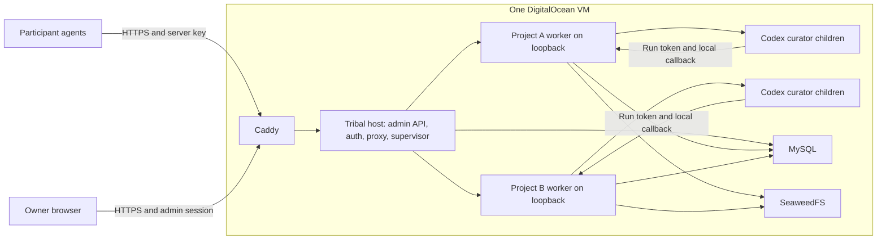

# Remote Tribal MCP launch design

Status: draft for review, 2026-11-08. This document proposes an implementation; it does not authorize a cloud purchase or claim a deployment. The user requested a detailed launch plan. Hosting and implementation choices below are recommendations.

## Goal and agreed requirements

Tribal lets its owner create project MCP servers that other people's agents can connect to remotely. The owner is the only administrator allowed to create servers. Participants authenticate with keys.

Proposed first-version behavior: each server has a separate project KB and HTTPS URL; the owner manages servers, named participants and keys in a small dashboard. A participant key grants both existing tools on one server. Participants need no dashboard accounts. These details are implementation defaults for review, rather than additional user-confirmed requirements.

## Current foundation

- `src/tribal-mcp-server/server.py` already assembles public `/mcp`, private `/internal/mcp`, graph/note APIs and activity SSE. Public HTTP is currently unauthenticated.
- `tribal_kb/configuration.py` configures one project per process through `TRIBAL_PROJECT_ID`. `runtime.py` owns in-memory curator/run tokens and launches concurrent `codex exec` children.
- `tribal_kb/storage.py` already scopes catalog queries and receipts by project. `service.py` prefixes immutable objects with a hash of project identity. These boundaries support shared physical storage, subject to explicit isolation checks.
- The existing React GUI is flat under `src/knowledge-base-gui/`. Its graph, note and EventSource URLs currently assume one project.
- The vault records successful local storage/publication. The application Docker image build and hosted curator execution remain unverified. Earlier embedding gaps are separate from launch; lexical retrieval is sufficient for the first deployment.
- The checkout contains unrelated modified and untracked work. Planning changes must preserve it; implementation should use an isolated checkout. Do not revive the removed GitHub/Kubernetes demo.

## Approaches

| Approach | Benefit | Cost |
| --- | --- | --- |
| One VM, one host application supervising a process per project | Reuses the existing single-project server; no Docker orchestration privileges in the web app | Processes share one OS identity and application container; the host application owns lifecycle recovery |
| One VM, a separate container per project | Better per-project resource boundaries; fits the earlier proposal | Needs a privileged provisioner or carefully restricted Docker control service, plus dynamic networking |
| A shared process with dynamically mounted project runtimes | Few operating-system processes | Requires changing runtime/lifespan ownership and private callback routing throughout the existing assembly |

**Recommended planning baseline:** the first approach. Earlier discussion suggested a container per project; a process per project inside one shared application container is a smaller first implementation. The owner still creates separate MCP endpoints and KBs. Select container isolation later if resource use or untrusted workloads require it. This baseline is not suitable for running user-supplied executables.

## Proposed deployment

Use Docker Compose for Caddy, the host application, MySQL, SeaweedFS and bucket initialization. Only Caddy publishes web ports. The host application contains the project workers and their loopback listeners; it mounts no Docker socket. MySQL and SeaweedFS persist in named volumes and expose no public ports. The application is one ASGI process; do not enable multiple Uvicorn workers.

Use one domain, e.g. `tribal.example.com`. A project endpoint is `https://tribal.example.com/servers/{server_id}/mcp`; `server_id` is a generated opaque ID, separate from its editable display name. Provisioning a project does not create another VM or DNS record.

Start with a measured candidate VM size of 2 vCPU / 4 GiB, at most three running project workers and two concurrent public `tools/call` requests across the host. These are conservative proposed limits, not established capacity. Keep idle workers running for this version. Measure memory during the first two-curator acceptance check before raising limits.

## Authentication and authorization

- Bootstrap one high-entropy admin access secret outside Git; configure only its SHA-256 digest as `TRIBAL_ADMIN_KEY_SHA256`. Admin login exchanges that separate secret for an eight-hour opaque session. Persist only session-token digests in MySQL. A human-chosen password would require password hashing instead; it is not the proposed login mechanism.
- Use a `Secure`, `HttpOnly`, `SameSite=Strict`, path `/` cookie named `__Host-tribal-admin`. Logout deletes the session row and cookie. Session responses expose a per-session CSRF token; state-changing admin requests require it in `X-CSRF-Token` and a matching configured Origin. A separately enabled loopback-only development mode uses a different non-Secure cookie name.
- Rate-limit failed admin login to five attempts per address per fifteen minutes. Trust forwarding information only from the configured Caddy hop; never accept an arbitrary incoming forwarded address.
- Participant records are labels and enabled/disabled flags. Generate a 256-bit random secret per key, associated with one participant and one server. Store a key ID, display prefix, SHA-256 digest, issue/revoke times and optional expiry. Return the full key only in the successful issuance response with `Cache-Control: no-store`; never return it from lists or put it in URLs/logs/localStorage.
- Participants send `Authorization: Bearer <key>` to the project MCP URL. Validate the key, participant and server association on every HTTP request, including initialization/discovery. Invalid/missing/expired/revoked keys return 401; an otherwise valid key for another server returns 403. User keys never authorize administration or graph inspection.
- Disabling a participant denies all their keys immediately for subsequent requests. Revocation does not cancel an already accepted curator request. Rotation issues a replacement before revoking the old key.
- Dashboard graphs, note reads and SSE require the admin session. Admin cookies alone do not authorize participant MCP calls. Public health reveals process liveness only.
- Key-based HTTP clients are the initial compatibility target. Do not promise OAuth-only clients or a hosted ChatGPT connector until separately verified.

## Registry and management API

Use the existing MySQL dependency and additive tables named `tribal_host_servers`, `tribal_host_users`, `tribal_host_keys` and `tribal_host_admin_sessions`. Keep them separate from the existing KB tables, especially the publication-lock table `tribal_projects`.

Server records contain `id`, `name`, unique creation replay ID, `desired_status`, assigned loopback port and timestamps. The project ID equals the generated server ID. Runtime observations/PIDs are process-owned, never treated as durable proof of a running worker. Key rows reference server and participant records. A participant record itself has no login credentials.

| Route | Contract |
| --- | --- |
| `POST /api/admin/login`, `POST /api/admin/logout`, `GET /api/admin/session` | Login with the admin secret; logout; get session/CSRF state |
| `GET /api/admin/servers`, `POST /api/admin/servers` | List; create from `{name, creation_id}` and return 202 with server ID, URL and observed status |
| `POST /api/admin/servers/{id}/start`, `/stop` | Persist desired state and schedule reconciliation; return 202 |
| `GET /api/admin/users`, `POST /api/admin/users`, `PATCH /api/admin/users/{id}` | List/create named participants; enable or disable |
| `GET /api/admin/servers/{id}/keys`, `POST /api/admin/servers/{id}/keys` | List metadata; issue a key for an enabled `user_id` |
| `POST /api/admin/keys/{id}/revoke` | Idempotent key revocation |
| `/api/admin/servers/{id}/graph`, `/notes/{note_id}`, `/activity` | Admin-only proxy of the selected worker's read APIs/SSE |
| `/servers/{id}/mcp` | Key-authorized proxy to that worker's `/mcp`; preserve protocol methods |

Validate names as trimmed text of 1–100 characters. Generate server/key/user IDs on the server. Repeating the same `creation_id` and name returns the existing server; changed input under that ID returns 409. Concurrent creates cannot reserve the same port. Failed key-delivery responses cannot recover the raw secret: revoke the undelivered key and issue another. Hard deletion and destructive KB removal are excluded.

## Worker lifecycle and proxy

- A supervisor launches `[sys.executable, '-m', 'server']` without a shell, with `HOST=127.0.0.1`, a reserved port in 32000–32031, the assigned project ID and `TRIBAL_INTERNAL_URL=http://127.0.0.1:{port}/internal/mcp`.
- Construct an explicit worker environment: process basics, shared storage settings, resource paths, selected Codex settings/credentials and optional embedding settings. Exclude admin/session/key material. Existing curator-child environment filtering remains intact.
- Creation transitions through starting to running only after a bounded 30-second health probe confirms the expected project ID. Health here means process readiness, not proven storage/model capability. Show failure clearly rather than returning a false ready state.
- Start/stop/create operations serialize per server. On manager startup reconcile durable desired state; restart crashed workers with delays 1/2/4 seconds, then mark failed after three consecutive failures. A stable sixty-second run resets the failure counter. A stopped worker remains stopped across restarts.
- A stop rejects new calls, sends SIGTERM and allows twenty seconds for normal shutdown. Curator children create their own process groups in the current runtime; killing only the worker group is insufficient. Supervisor cleanup must also track and terminate owned descendant groups after the grace period, and verify no surviving Codex descendants before reporting stopped/restarting. Never signal a PID recovered solely from an old database row. Container `init: true` helps reap processes but does not replace this ownership/cleanup requirement.
- Proxy only explicitly allowed MCP and admin-read routes. `/internal/mcp`, arbitrary worker paths and backend health are never forwarded publicly. Do not derive upstream hosts/ports from request parameters; use the registry and supervisor.
- Preserve MCP protocol/Accept/content headers and response status/streaming. Strip incoming participant Authorization, cookies and forwarding headers before forwarding; set upstream Host from trusted loopback configuration. Validate any supplied Origin against the configured public origin before dropping it at the trusted internal hop. Disable redirects and never buffer an SSE response to completion.
- Set connect timeout five seconds and MCP read timeout curator timeout plus sixty seconds (360 seconds initially). Bound input bodies to 1 MiB. Reject excess concurrent public `tools/call` requests with 429 and `Retry-After`; initialization/discovery do not reserve a curator slot. Release slots on error/disconnect and ensure cancellation cleans up upstream runs. Limit worker creation to the configured running-worker cap.
- Serve both supported canonical/trailing-slash MCP paths without HTTP redirects. Preserve percent-encoded stable note IDs. Unknown servers return 404; known stopped/starting/failed servers return 503 with a safe retry hint.
- Request IDs retain the current project-wide replay contract. Connection instructions generate a fresh UUID per distinct update and reuse it only for an identical retry. Do not silently retry a potentially published update under a new ID.

## Dashboard and connection experience

Reuse React/Vite and existing styles. The admin shell has login, servers and users/keys views. Server details show status, copyable MCP URL, start/stop, access-key controls and the existing graph/activity/reader. Show a newly issued key once, and keep it only in component memory until dismissed.

Parameterize graph, note and activity URL bases. Remount the explorer by server ID when selection changes; abort old fetches, close old EventSource connections, clear note/activity state and prevent late responses from showing another project's data. Browser EventSource uses the same-origin admin session cookie. The old local single-project mode keeps its existing URLs.

Connection instructions use a generic remote-MCP URL plus an Authorization bearer header; client-specific secret/environment syntax must be verified for each advertised client. Verify at least two separately configured clients. Standard tools remain exactly `seed_agent_context` and `update_knowledge_base`; no public provisioning tools are added.

## Launch, recovery and limits

First prove the existing runtime image builds and completes live curation in a private environment. For automation, official Codex docs recommend API-key authentication; device-code login is an alternative when account settings permit it. Use the server's own approved credentials, never participant keys. Verify the installed CLI's handling before choosing how to inject them. Keep optional embeddings off initially; retain lexical retrieval. Set operator-side model spending limits separately from public concurrency controls.

Then provision one DigitalOcean VM and domain, install Docker/Compose, deploy the host stack and Caddy, authenticate the server's Codex and create one project from the admin UI. Caddy handles HTTPS certificate issuance/renewal. Open web ports 80/443; restrict SSH to the owner's source network. Keep stores and worker ports private. Set actual storage credentials explicitly; remote configuration must fail if required values are missing rather than inherit local demo defaults.

Enable persistent MySQL, SeaweedFS, Codex auth and Caddy certificate volumes. For the initial backup procedure, stop/drain the host application, dump MySQL and back up SeaweedFS while writes are paused; restart the application. Store encrypted backups off the VM and prove restore in an isolated environment. Retain the prior application image and registry schema; rollback changes application images without deleting data or blindly replaying interrupted writes. In-flight activity is transient after restart; durable receipts/notes survive.

Non-goals: Kubernetes, GitHub SSO/OAuth login, public signup, user-supplied tools/code/images, per-user Codex login, per-project VMs, distributed workers, durable activity replay, public graph access and hard deletion. Shared process identity means logical project isolation, not a hostile tenant boundary. Image build/provider access, domain/DNS, owner admin secret and server model credentials are deployment inputs, not blockers to writing this plan.

## Launch acceptance

1. Two users connect remotely to server A; discovery exposes exactly two tools; both retrieve/publish real context.
2. Server B has different notes. An A key cannot call B, the admin API, private tools or graph/note/activity endpoints.
3. Revoking a key or disabling its participant rejects their next MCP request, including discovery.
4. An update is confirmed by saved-note readback, graph refresh and subsequent seed retrieval. An interrupted identical retry replays its durable result.
5. Dashboard project switching never displays old graph/note/activity state. Browser session/CSRF and logout behave as designed.
6. Stop/start and application/VM restart preserve records, desired states, keys and notes; no duplicate workers or orphan Codex processes remain.
7. A long curator operation and SSE survive the proxy, and errors/cancellation release concurrency slots. Capacity rejection is explicit.
8. A paused-write backup restores into an isolated stack and the previous application image can run against its data.

No new tests are authorized by this planning request. Implementation uses documented manual acceptance and the existing relevant suites unless the user explicitly authorizes new test authorship.

## Primary references checked 2026-11-08

- [DigitalOcean VM creation](https://docs.digitalocean.com/products/droplets/how-to/create/)
- [Caddy automatic HTTPS](https://caddyserver.com/docs/automatic-https)
- [FastMCP HTTP deployment](https://gofastmcp.com/docs/deployment/http)
- [MCP Streamable HTTP](https://modelcontextprotocol.io/specification/2026-07-28/basic/transports/streamable-http)
- [Codex authentication and headless login](https://learn.chatgpt.com/docs/auth)
- [Docker security and daemon access](https://docs.docker.com/engine/security/)
