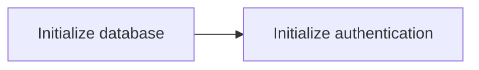

# Startup

## Initialization

This synthetic example records a verification assertion, not a test
executed by this fixture package. Database initialization precedes auth.

| Component | Reference |
|---|---|
| Database | [[database/Setup\|Connection setup]] |

The diagram shows that startup ordering.



```typescript
// [[Not a link]] is literal example text.
await connectDatabase();
await initializeAuth();
```

## Related knowledge

- [[Setup]]
- [[Guide]]
- [Root guide](../Guide.md)
- [[database/Guide]]
- [[database/Setup#Initialization|Setup details]]
